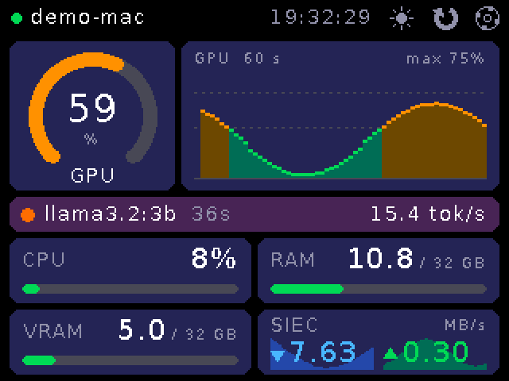
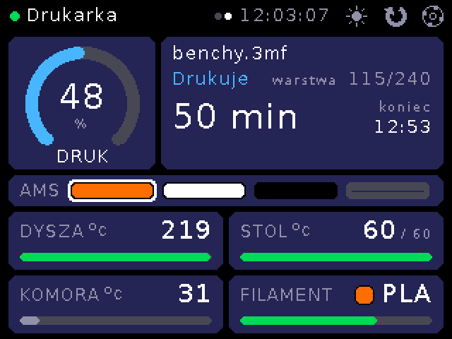

# GPU Tray (macOS)

[](https://github.com/honzo90/gpu_tray/actions/workflows/build.yml)
[](LICENSE)

Natywna aplikacja w pasku menu dla **Apple Silicon**, która pokazuje:

- **użycie GPU na żywo** (co 1 s, bez uprawnień root — odczyt z IOKit `AGXAccelerator`),
- **status Ollama**: czy właśnie generuje (⚡ pulsująca ikona), jakie modele siedzą w VRAM, ile zostało do auto-unloadu,
- **szybkość generowania** (tok/s) parsowaną z logu `~/.ollama/logs/server.log`,
- **powiadomienia macOS** przy starcie i końcu generowania,
- **zewnętrzny ekranik** [CYD (ESP32)](#ekran-cyd-esp32) z dashboardem GPU/CPU/RAM/sieci/Ollamy — dane po UDP w sieci lokalnej.

<p align="center">
  
  <br><sub>Dashboard na CYD (zrzut z płytki, dane testowe z <code>--screen-test</code>)</sub>
</p>

Zbudowana i przetestowana na **Mac Studio M1 Max, 32 GB, macOS 27.2** z Ollama 0.40.16.

## Instalacja

```bash
./build_app.sh          # buduje, podpisuje i instaluje do /Applications
open /Applications/GPUTray.app
```

Alternatywnie do katalogu użytkownika: `./build_app.sh --user`.

Gotowe buildy (aplikacja z podpisem ad-hoc i firmware `.bin`) są w
[Releases](https://github.com/honzo90/gpu_tray/releases) — z instrukcją instalacji i wgrywania —
a wersje rozwojowe w artefaktach [GitHub Actions](https://github.com/honzo90/gpu_tray/actions/workflows/build.yml)
dla każdego pusha do `main`.

Nowe wydanie: `git tag v1.2.0 && git push origin v1.2.0` — workflow `release.yml` zbuduje wszystko
i opublikuje release (wersja aplikacji z taga).

**Podpis:** skrypt podpisuje pierwszym certyfikatem „Apple Development" z pęku kluczy
(inny wskażesz przez `SIGN_ID=<SHA-1 lub nazwa> ./build_app.sh`). Stała tożsamość sprawia,
że zgody macOS (powiadomienia, Sieć lokalna) przetrwają przebudowy. Bez certyfikatu skrypt
podpisuje ad-hoc — wtedy po każdym buildzie macOS może pytać o zgody od nowa.

- **Autostart przy logowaniu** włącz w menu aplikacji: „🚀 Uruchamiaj przy logowaniu"
  (tworzy `~/Library/LaunchAgents/com.gputray.agent.plist`).
- Przy pierwszym uruchomieniu macOS zapyta o zgodę na **powiadomienia** — kliknij „Zezwól",
  inaczej powiadomienia start/koniec generowania nie będą się pokazywać.

## Ikona w pasku menu

| Wygląd | Znaczenie |
|---|---|
| `42%` (kolor standardowy) | GPU poniżej 50% |
| `42%` pomarańczowe | GPU ≥ 50% |
| `42%` czerwone | GPU ≥ 85% |
| `● 100%` pulsująca kropka | **Ollama generuje** (pomarańczowa ↔ czerwona, ~1,4 Hz) |
| `—` | brak odczytu GPU (nie Apple Silicon?) |

## Menu rozwijane

- nagłówek statusu: ⚡ pracuje / 💤 bezczynny / ⚠️ brak serwera,
- paski: GPU (ogółem), Renderer, Tiler, Pamięć GPU, Pamięć zintegrowana,
- lista załadowanych modeli: VRAM, % na GPU, kontekst, licznik auto-unloadu,
- ostatnia generacja: tok/s + godzina,
- akcje: **Zatrzymaj model** (POST `/api/generate` z `keep_alive: 0`), przełącznik autostartu, otwarcie logów Ollama,
- „🖨 Drukarka": stan drukarki Bambu Lab (drukuje 42% · zostało 1:23 / bezczynna / błąd połączenia);
  kliknięcie otwiera okno z adresem IP, numerem seryjnym i kodem dostępu LAN,
- „🖥 Ekran ESP32": `podłączony (IP)` gdy CYD pyta o dane, inaczej czas od ostatniego zapytania.

## Konfiguracja (`defaults write com.gputray.app <klucz> <wartość`)

| Klucz | Domyślnie | Opis |
|---|---|---|
| `gpuBusyThreshold` | `60` | próg % GPU uznawany za „Ollama pracuje" (np. `-float 75`) |
| `ollamaBaseURL` | auto | wymuszony adres serwera (np. `http://192.168.1.50:11434`) |
| `ollamaPort` | `11434` | port serwera Ollama |
| `bambuHost` | — | IP drukarki Bambu Lab (ustawiane też z menu „🖨 Drukarka") |
| `bambuSerial` | — | numer seryjny drukarki |
| `bambuAccessCode` | — | kod dostępu LAN z ekranu drukarki; bez niego klient drukarki jest wyłączony |

Auto-detekcja adresu serwera: `ollamaBaseURL` (jeśli ustawiony) → `127.0.0.1` → `localhost` → adresy nasłuchu z `lsof`.
Jeśli Ollama słucha tylko na IP LAN (np. `OLLAMA_HOST=192.168.1.50`), aplikacja sama to wykrywa.

Przykład — wymuszenie adresu i powrót do auto-detekcji (po zmianie zrestartuj GPU Tray):

```bash
defaults write com.gputray.app ollamaBaseURL "http://192.168.1.50:11434"
defaults delete com.gputray.app ollamaBaseURL
```

## Diagnostyka

```bash
/Applications/GPUTray.app/Contents/MacOS/GPUTray --once   # jeden snapshot wszystkich źródeł (też sieć i CPU)
GPU_TRAY_DEBUG=1 /Applications/GPUTray.app/Contents/MacOS/GPUTray   # log do ~/Library/Logs/GPUTray-debug.log
.build/debug/gpu-tray --screen-test   # responder UDP z danymi syntetycznymi (test CYD bez GUI)
/Applications/GPUTray.app/Contents/MacOS/GPUTray --bambu-dump   # surowe raporty MQTT drukarki (dane z ustawień)
```

## Ekran CYD (ESP32)

Opcjonalny ekranik **ESP32-2432S028R** („Cheap Yellow Display": 2,8" ILI9341 320×240 + dotyk XPT2046)
pokazuje statystyki Maca. Firmware w `esp32/gpu_cyd/`.

### Wgrywanie

Wymagania: `arduino-cli` z rdzeniem `esp32:esp32` (3.x) oraz bibliotekami **LovyanGFX** i **ArduinoJson** (7.x).

```bash
cd esp32
./build_esp32.sh           # kompilacja + wgranie (port /dev/cu.usbserial-* wykrywany sam)
./build_esp32.sh build     # sama kompilacja
./build_esp32.sh monitor   # podgląd portu szeregowego (115200)
./build_esp32.sh erase     # wymazanie flasha, w tym wszystkich ustawień
CYD_PORT=/dev/cu.usbserial-XXXX ./build_esp32.sh   # port ręcznie
```

Pierwszy build trwa kilka minut (indeksowanie LovyanGFX), kolejne ok. 20 s.

Schemat partycji: **Minimal SPIFFS** (`PartitionScheme=min_spiffs`, 2 × 1,9 MB na aplikację z OTA) —
firmware z HTTPS nie mieści się w domyślnych 1,25 MB. **Przejście z wersji ≤ 1.3.0 na 1.4.0+ wymaga
jednorazowego wgrania kablem**: `./build_esp32.sh` zachowuje ustawienia (NVS pod tym samym adresem),
`-full.bin` z Releases to obraz całego flasha i kasuje ustawienia.
Jeśli portu nie ma w `/dev/cu.usbserial-*`, najczęściej winny jest kabel tylko do ładowania
albo luźna wtyczka micro-USB.

### Pierwsze uruchomienie

1. **Kalibracja dotyku** — dotknij i chwilę przytrzymaj kolejno 4 cele, potem dotknij OK (pudło = kalibracja od nowa).
2. **Wi-Fi** — wybierz sieć z listy (sortowana po sile sygnału), wpisz hasło klawiaturą ekranową
   (`123` przełącza cyfry/symbole na stałe, `***` pokazuje hasło), naciśnij **POLACZ**.
   Złe hasło → powrót do klawiatury.
3. Ekran sam znajduje Maca (broadcast w podsieci) — wystarczy uruchomiony GPU Tray.

Wszystko zapisuje się w pamięci płytki; po restarcie CYD łączy się automatycznie.

### Dashboard


- **kropka w nagłówku**: zielona = dane świeże, czerwona = Mac przestał odpowiadać, szara = jeszcze brak danych,
- **wskaźnik GPU** (wygładzony) i **historia 60 s** z liniami progów 50% / 85%,
- **pasek Ollama**: kropka pulsuje przy generowaniu (model + czas generacji), zielona = niedawny pomiar tok/s,
- **kafelki** CPU, RAM, VRAM i sieć (pobieranie/wysyłanie w MB/s z historią w tle),
- kolory progów jak w pasku menu: zielony < 50% ≤ pomarańczowy < 85% ≤ czerwony.

### Sterowanie (ikony w nagłówku)

| Ikona | Działanie |
|---|---|
| ☀ | następny poziom jasności (5 poziomów: 20–180 z 255, w kółko); na chwilę pokazuje okienko z poziomem |
| ↻ | obrót ekranu o kolejne 90° (0° → 90° → 180° → 270°); 90° i 270° to dashboard w pionie (240×320). Dotyk działa bez ponownej kalibracji |
| ⚙ | konfiguracja Wi-Fi (lista sieci; `X` zamyka bez zmian) |

W pionie (90°/270°) dashboard ma układ: wskaźnik GPU z kafelkami CPU/RAM obok, pasek Ollama,
historia GPU na całą szerokość, pod nią VRAM i sieć. Kalibracja, konfiguracja Wi-Fi, kod logowania
i ekran aktualizacji zostają w poziomie (przy 90° jak 0°, przy 270° jak 180°).

Jasność jest ograniczona do 180/255 celowo: CYD ma słaby stabilizator (AMS1117) i pełne
podświetlenie razem ze skokiem prądu Wi-Fi potrafi zresetować płytkę.

### Strona drukarki Bambu Lab



**Przesunięcie palcem z prawej na lewą** (poza nagłówkiem) otwiera stronę drukarki,
z lewej na prawą wraca do statystyk Maca. Dwie kropki w nagłówku pokazują aktywną stronę.

- **postęp** (pierścień: niebieski = drukuje, pomarańczowy = pauza, zielony = gotowe, czerwony = błąd),
- **plik, stan, warstwa**, **czas do końca** i **godzina zakończenia** (wg zegara Maca),
- **AMS**: kolory 4 slotów, aktywny (lub ostatnio użyty) w białej ramce,
- **dysza / stół / komora** — temperatura aktualna i docelowa, pasek nagrzewania,
- **filament**: kolor, typ i pozostała ilość na szpuli.

Dane zbiera GPU Tray na Macu — lokalne MQTT drukarki (TLS, port 8883, użytkownik `bblp`,
hasło = kod dostępu LAN) — i dokleja je do pakietu dla CYD. Konfiguracja: menu **🖨 Drukarka**
(IP i kod: na drukarce *Ustawienia → WLAN*; numer seryjny: *Ustawienia → Urządzenie*).
Działa także w trybie chmury; jeśli drukarka odrzuca połączenie (nowsze firmware z kontrolą
autoryzacji), włącz na niej tryb LAN lub Developer Mode. Sprawdzone na P2S; pola raportu
pozostałych modeli są w większości takie same (`--bambu-dump` pokazuje, co przychodzi).

### Zrzut ekranu

Firmware na literę `S` z portu szeregowego odsyła bufor dashboardu; skrypt zapisuje go jako PNG
(wymaga tylko `pyserial`):

```bash
python3 esp32/cyd_screenshot.py zrzut.png --wait 70   # 70 s → pełna historia GPU
python3 esp32/cyd_screenshot.py druk.png --print       # strona drukarki
python3 esp32/cyd_screenshot.py pion.png --rot 1       # obrót o 90° na czas zrzutu (bez zapisu)
```

Polecenia z portu szeregowego (115200): `S` zrzut, `P` następna strona, `R` obrót o 90° bez zapisu.

Na macOS otwarcie portu resetuje płytkę, stąd `--wait` (domyślnie 12 s) na połączenie z Wi-Fi i dane.
Neutralny zrzut (host `demo-mac`, przykładowy model) daje `.build/debug/gpu-tray --screen-test`
uruchomiony zamiast GPU Tray.

### Tryb nocny

W godzinach **22:00–7:00** (wg zegara Maca) podświetlenie jest wyłączone. Dotknięcie budzi ekran
na 30 s z wybraną jasnością — pierwsze dotknięcie tylko budzi (nie klika przycisków), kolejne
przedłużają. Bez danych z Maca tryb nocny jest nieaktywny. Godziny, czas wybudzenia i samo
włączenie trybu zmienisz w panelu WWW (poniżej).

### Panel WWW z ustawieniami

Po połączeniu z Wi-Fi CYD wystawia stronę ustawień pod **http://gpu-cyd.local** (mDNS) lub
`http://<IP CYD>` (IP widać na ekranie po połączeniu). Na stronie:

- **stan**: Mac (host, IP, świeżość danych), czas z Maca, Wi-Fi + RSSI, tryb nocny, uptime,
- **ekran**: jasność (suwak 1–5) i obrót 0° / 90° / 180° / 270° — zmiany od razu na ekranie,
- **tryb nocny**: włącz/wyłącz, godziny od–do, czas wybudzenia dotykiem (5–600 s),
- **Wi-Fi**: skanowanie, wybór sieci, hasło (puste przy tej samej sieci = bez zmiany) → zapis i restart,
- **firmware**: wersja i aktualizacja bez kabla (OTA), ustawienia zostają:
  - *Sprawdź aktualizacje* → CYD pyta GitHub o najnowsze [wydanie](https://github.com/honzo90/gpu_tray/releases)
    i po kliknięciu *Zainstaluj* sam pobiera `gpu_cyd-<v>-update.bin` (HTTPS z weryfikacją certyfikatu,
    wbudowany zestaw CA rdzenia ESP32); instaluje tylko, gdy SHA-256 zgadza się z `SHA256SUMS.txt`,
  - albo ręcznie: wybór pliku `gpu_cyd-<v>-update.bin` z dysku,
- **urządzenie**: restart, ponowna kalibracja dotyku, wylogowanie.

#### Logowanie

Panel jest chroniony kodem z ekranu CYD — kto nie widzi ekranu, ten się nie zaloguje:

1. **Ukryty gest na CYD**: przytrzymaj ok. 1,5 s nazwę hosta w nagłówku dashboardu
   (albo w panelu kliknij *Pokaż kod na ekranie CYD*).
2. CYD przez 60 s pokazuje **kod QR** i **6 cyfr** (także w trybie nocnym; dotknięcie ekranu anuluje).
3. Zeskanuj QR telefonem — od razu otwiera zalogowany panel — albo wpisz cyfry w przeglądarce.

Przeglądarka zostaje zalogowana na rok (cookie `HttpOnly`); CYD pamięta 4 ostatnie przeglądarki
(NVS `toks`). W panelu: *Wyloguj* / *Wyloguj wszystkie przeglądarki*. Ochrona przed zgadywaniem:
nowy kod z sieci najwyżej raz na minutę, 5 prób na kod. Bez tokenu każde `/api/*` zwraca 401,
a aktualizacja firmware odrzuca plik, zanim cokolwiek zapisze do flasha.

#### API

JSON do skryptów (wymaga cookie `cydtok`): `GET /api/status`, `GET|POST /api/settings`,
`GET /api/scan`, `POST /api/wifi`, `/api/restart`, `/api/calibrate`, `/api/update` (multipart);
logowanie: `POST /api/login/start`, `POST /api/login {"code":"123456"}`, `POST /api/logout`. Np.:

```bash
curl -s -c cyd.txt http://gpu-cyd.local/api/login -H 'Content-Type: application/json' -d '{"code":"123456"}'
curl -s -b cyd.txt http://gpu-cyd.local/api/settings -H 'Content-Type: application/json' -d '{"bri":2,"night":{"from":"23:00","to":"06:30"}}'
```

### Ustawienia w pamięci płytki (NVS, przestrzeń `gpucyd`)

| Klucz | Znaczenie |
|---|---|
| `ssid`, `pass` | dane Wi-Fi |
| `sx1`, `sx2`, `sy1`, `sy2`, `xfy`, `yfx`, `calv` | kalibracja dotyku |
| `rot` | obrót: 0–3 (×90°); starszy `rot180` jest odczytywany, gdy `rot` brak |
| `bri` | poziom jasności (indeks 0–4) |
| `non`, `nfr`, `nto`, `nwk` | tryb nocny: włączony, od / do (minuty od północy), wybudzenie (s) |
| `toks` | tokeny zalogowanych przeglądarek panelu WWW (do 4) |

Reset wszystkich ustawień: `./build_esp32.sh erase`, potem ponowne wgranie.

### Protokół (UDP, port 45678 na Macu)

CYD co 1 s wysyła `CYDREQ\n` — broadcastem, dopóki nie zna IP Maca, potem bezpośrednio.
GPU Tray odpowiada jednym JSON-em na adres i port nadawcy:

```json
{"h":"host","t":"HH:mm:ss","gpu":42,"cpu":17.5,"mem":24.1,"memT":32,"vgpu":21.6,
 "nd":1.23,"nu":0.12,"busy":1,"gen":187,"model":"qwen2.5-coder","tok":38.5,"tokA":12}
```

`gpu`/`cpu` w %, pamięć w GB, sieć w MB/s, `gen` = czas bieżącej generacji (s, tylko gdy `busy`),
`tokA` = wiek ostatniego pomiaru tok/s (s). Pola bez odczytu są pomijane.

Gdy drukarka jest skonfigurowana, dochodzi obiekt `p` (teksty w ASCII — fonty CYD nie mają diakrytyków):

```json
"p":{"ok":1,"age":0,"st":"RUNNING","pct":42,"rem":83,"ly":120,"lyT":300,"f":"benchy.3mf",
     "nz":219.6,"nzT":220,"bd":60,"bdT":60,"ch":31,"fil":"PLA","col":"FF6A13","fr":72,
     "ams":"FF6A13,FFFFFF,161616,","act":0}
```

`ok` = połączenie z drukarką, `age` = s od ostatniego raportu (-1 = brak), `rem` w minutach,
`ams` = kolory slotów (puste = brak szpuli), `act` = aktywny slot, `err` = kod błędu (gdy ≠ 0).

## Jak to działa (źródła danych, wszystkie bez roota)

| Dane | Źródło | Częstotliwość |
|---|---|---|
| Użycie GPU % + pamięć GPU | IOKit `AGXAccelerator` → `PerformanceStatistics` (`ioreg -r -d 1 -c AGXAccelerator`) | 1 s |
| Modele, VRAM, auto-unload | HTTP `GET /api/ps` | 2 s |
| tok/s | tail `~/.ollama/logs/server.log` (llama.cpp `print_timing`) | na żywo |
| „Ollama pracuje" | GPU ≥ próg przy załadowanym modelu, debounce: start po 2 s, koniec po 3 s ciszy | 1 s |
| Drukarka Bambu Lab | lokalne MQTT/TLS `device/<serial>/report` (raz `pushall`, potem raporty drukarki) | na żywo |

Uwaga: przy odtwarzaniu wideo/grach GPU też rośnie — jeśli model jest wtedy załadowany,
może pojawić się fałszywe „pracuje". Podnieś wtedy `gpuBusyThreshold`.

## Struktura projektu

```
Sources/GPUTray/
  main.swift               # bootstrap aplikacji (LSUIElement — bez ikony w Docku)
  StatusBarController.swift # pasek menu + menu rozwijane
  GPUStats.swift           # IOKit: GPU + pamięć hosta
  NetStats.swift           # ruch sieci (en*) i CPU
  OllamaClient.swift       # HTTP /api/ps, auto-detekcja adresu, unload
  LogParser.swift          # tail server.log → tok/s
  ActivityMonitor.swift    # maszyna stanów pracuje/bezczynny
  Notifier.swift           # powiadomienia UNUserNotificationCenter
  Autostart.swift          # LaunchAgent
  ESP32Link.swift          # responder UDP dla ekranu CYD
  BambuClient.swift        # klient MQTT drukarki Bambu Lab (stan druku, AMS, temperatury)
  ScreenTest.swift         # --screen-test: dane syntetyczne dla CYD
  Formatters.swift, DebugLog.swift, Diagnostics.swift
build_app.sh               # build → GPUTray.app → codesign → instalacja
esp32/
  build_esp32.sh           # kompilacja/wgranie/monitor/erase firmware
  cyd_screenshot.py        # zrzut ekranu dashboardu do PNG
  gpu_cyd/
    gpu_cyd.ino            # maszyna stanów, UDP, jasność, obrót, tryb nocny, gesty
    gfx.h                  # konfiguracja LovyanGFX dla CYD, paleta, helpery
    ui_dash.h              # dashboard i strona drukarki (sprite 8bpp, bez migotania)
    ui_wifi.h              # kalibracja dotyku, lista sieci, klawiatura
    web.h                  # panel WWW: ustawienia, API JSON, OTA, logowanie kodem/QR
```

## Licencja

[MIT](LICENSE) © 2026 Rafael Pawelek.
Firmware korzysta z bibliotek [LovyanGFX](https://github.com/lovyan03/LovyanGFX) (licencja FreeBSD)
i [ArduinoJson](https://github.com/bblanchon/ArduinoJson) (MIT) — nie są dołączone do repo, instaluje się je osobno.
